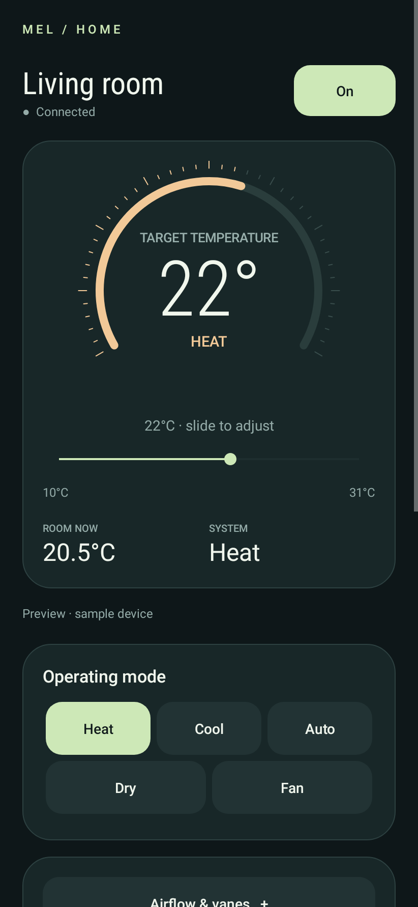
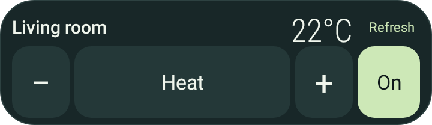

<div align="center">

# MEL Android Wrapper

**A lightweight Android controller for Mitsubishi MELCloud Home.**

Native Kotlin · Android 8+ · Direct cloud connection

[Download the latest APK](https://github.com/diogux/mel-android-wrapper/releases/latest/download/mel-android-wrapper.apk) · [Installation & usage](docs/usage.md) · [Build from source](CONTRIBUTING.md)

[](https://github.com/diogux/mel-android-wrapper/actions/workflows/android.yml)

</div>

## A quieter way to control your room

Power, temperature, mode, fan speed and supported vane settings in a simple native interface. A resizable home-screen widget keeps the everyday controls close at hand. The app connects directly to the **newer MELCloud Home API** using your existing Mitsubishi account.

<table>
<tr><th>Dashboard</th><th>Home-screen widget</th></tr>
<tr>
<td valign="top" align="center"></td>
<td valign="top" align="center"><p><sub>Previews use sample device data.</sub></p></td>
</tr>
</table>

## Features

- **Everyday control:** power, room/target temperature, supported modes and fan speeds.
- **Airflow:** supported vertical/horizontal vane positions, Auto and Swing.
- **Temperature slider:** rapid edits settle for three seconds, then send one final command.
- **Home-screen widget:** power, mode, temperature and refresh, with responsive layouts and larger controls inside the existing widget box.
- **Phone schedules:** repeat by weekday, with power, mode and optional target temperature.
- **Energy:** seven-day reported consumption in kWh, when the device exposes energy telemetry.
- **Existing devices:** automatic selection for a single unit, selection for multiple owned/shared units.
- **Private sessions:** browser-based OAuth PKCE login, automatic token refresh and Android Keystore encryption.

The app needs no additional server, hardware, subscription or app-specific account. There are no ads, analytics or persistent background polling.

## Install

1. [Download `mel-android-wrapper.apk`](https://github.com/diogux/mel-android-wrapper/releases/latest/download/mel-android-wrapper.apk) from the **Latest** release and open it on your Android phone.
2. Allow installation from your chosen browser/file manager if Android asks.
3. Open **Air Conditioner**, connect MELCloud Home and sign in in your browser.
4. Choose **Air Conditioner** when Android asks which app should receive the sign-in callback.

Future APKs use the same filename and the same signing identity so they can update the existing app. APK binaries live only in the rolling **Latest** release—not in the source tree or a collection of versioned downloads.

For widget setup, browser callback conflicts, alarm access and troubleshooting, see [usage](docs/usage.md).

## Things to know

**Unofficial client.** This project is not affiliated with Mitsubishi Electric. It uses an undocumented API that Mitsubishi may change.

**Phone schedules run on your phone.** Keep it powered on, signed in and online, with Alarms & reminders access enabled. Android may delay network work. Existing Mitsubishi cloud schedules are displayed read-only; edit those in the official app.

**Energy depends on the device.** Missing readings are shown as missing, not zero. Reported cloud energy can lag and is not a real-time power or billing-grade measurement.

**Cloud acceptance is not hardware confirmation.** Allow for propagation and refresh state. The three-second spacing is a configurable implementation choice, not a verified hardware requirement.

The implementation has automated protocol, queue, alarm, Android compatibility and rendering tests. Live end-to-end AC/launcher behavior is not covered by those tests. See [verification](TESTING.md).

## Development

Requires JDK 17/21 and Android SDK platform 35 / build-tools 35.0.0.

```sh
export ANDROID_HOME=/path/to/android-sdk
./gradlew :app:assembleDebug :app:testDebugUnitTest :app:lintDebug
```

The APK is generated at `app/build/outputs/apk/debug/app-debug.apk`. See [contributing](CONTRIBUTING.md), [architecture & protocol](docs/architecture.md), and [release publishing](docs/releases.md).

## License & acknowledgements

[MIT](LICENSE). Protocol research and an anonymized test fixture build on [Andrew Blake's melcloudhome](https://github.com/andrew-blake/melcloudhome) and [Erwin Douna's aiomelcloudhome](https://github.com/erwindouna/aiomelcloudhome). Their MIT notices are retained in [licenses/](licenses/). Exact inspected revisions are recorded in [research.json](research.json).
